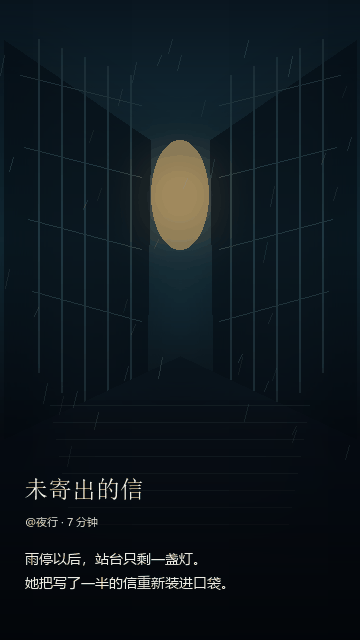

# 手机滑动方向提示参考

状态：光流牵引已选用；其余效果归档备用｜产品：信息雨分发产品｜用途：比较分支方向提示与作品切换的整体运动

每个 GIF 都完整展示四个方向：左滑、右滑、上滑分别进入三条分支，下滑整屏切换到下一部作品。标题、作者和正文都属于阅读画面，会和当前页面一起离开；没有箭头、浮动文字框或独立漂移字幕。左、右、上三个片段之间的短暂暗场只是为了把画面重置到同一初始页，方便逐段比较，不代表产品切换时会黑屏。

GIF 是运动关系草案，不代表最终美术风格、动效时长或手势阈值。真实页面应由手指持续控制；松手后才完成吸附或回弹。

当前采用**光流牵引**。另外两套 GIF（图像开口、场景吸入）继续保留，作为后续迭代参考，不属于当前实现。每套都用同一套故事和四向映射来演示；下滑切换作品在三套方案中保持一致：整屏上下交接，不套用分支提示效果。

## 三种故事分支提示

### 1. 光流牵引

光从当前场景中流向被选中的边缘。画面文字保持排版，跟着整张阅读画面移动；不额外生成浮层。

[打开光流牵引 GIF](四向-光流牵引.gif)

### 2. 图像开口

目标场景从柔和扩大的开口中显现。当前页与文字作为一个整体离场；方向由开口从哪一侧展开表达，不靠整页跟手位移。

[打开图像开口 GIF](四向-图像开口.gif)

### 3. 场景吸入

整张当前阅读页（包括标题与正文）向选择方向收窄并离开，场景光点同时朝该方向汇流。它强调“整页被带走”，与前两种方案的整页平移、开口揭示在运动机制上不同。

[打开场景吸入 GIF](四向-场景吸入.gif)

每个 GIF 的最后一段都是相同的下滑整屏切换：当前作品向下离开，下一部作品从上方进入，文字始终属于各自作品画面。

## 流程体验验收标准（草案）

验收对象是从浏览到继续阅读的一段真实流程，而不是单帧截图或某个 CSS 动画单独通过。

| 流程 | 验收时的体验结果 |
| --- | --- |
| 浏览作品 | 一次下滑只进入紧邻的下一部作品；页面整屏连续移动，目标作品稳定落位后可立即阅读，不重复切换。作品流边界不会把读者送进空白页。 |
| 进入并阅读 | 进入作品后能在舞台阅读；长正文可正常滚动，滚动过程不会意外选择分支或切走作品。正文滚动与导航交接规则在整个页面保持一致。 |
| 选择分支 | 有三条出口的节点上，左、右、上分别进入内容定义的对应目标。方向提示由光线或图像运动表达，不显示方向箭头或悬浮提示框。没有对应出口时不误入别的分支或作品。 |
| 完成分支切换 | 拖动时当前画面跟随手指；标题、作者和正文随当前画面一起离场。目标画面从对应方向连续进入。未达到提交条件时当前页自然回弹，文本不脱层、不闪烁、不延迟换页。 |
| 连续阅读 | 转场完成后，下一次滚动或选择仍只触发一次；节点正文位置、作品信息和视觉状态彼此一致，不残留旧快照、旧提示或锁定状态。 |
| 返回与边界 | 读者能通过已确定的返回方式回到之前的作品；首尾作品、无上分支节点和中途取消手势都有可理解的结果。**返回上一部作品的具体交互仍待定，不能在验收时假定它已解决。** |

通过标准：读者完成这条流程时，每次移动的结果都可预期；分支与作品切换不串线；手指移动、文字离场和目标进入属于同一段连续运动；无需箭头或浮动解释框补救。若任一环节需要反复试划、发生误切或让文字脱离原画面，则该流程不通过，回到原型继续打磨。

第一次验证需覆盖：三出口与两出口节点、短文与长文、文字尺寸三档、正文可滚动和滚动到边界、普通手势与中途取消、作品流首尾边界，以及 iOS Safari 和 Android Chrome。当前仅建立验收标准与视觉样例，不代表已安排 Demo 试玩或真机验收。

## 开源交互参考

- [Swiper 官方 API](https://swiperjs.com/swiper-api)：项目已采用；参考整屏分页、滑动阈值、转场期间的交互锁定和触摸区域排除。
- [SwipeFeed GitHub](https://github.com/briansunter/swipefeed)：参考 headless feed 的统一方向锁定、活动页管理和邻页预备；它依赖 React 19，暂不作为可直接移植的依赖。

参考成熟项目的手势协调与页面组织，再用信息雨自己的内容画面表达方向；不照搬它们的箭头、视频 UI 或整套组件外观。

## GIF 生成

在此目录运行 `python make_motion_examples.py` 可重建三套四向 GIF。脚本只用于文档视觉样例，不进入读者网页构建包。
