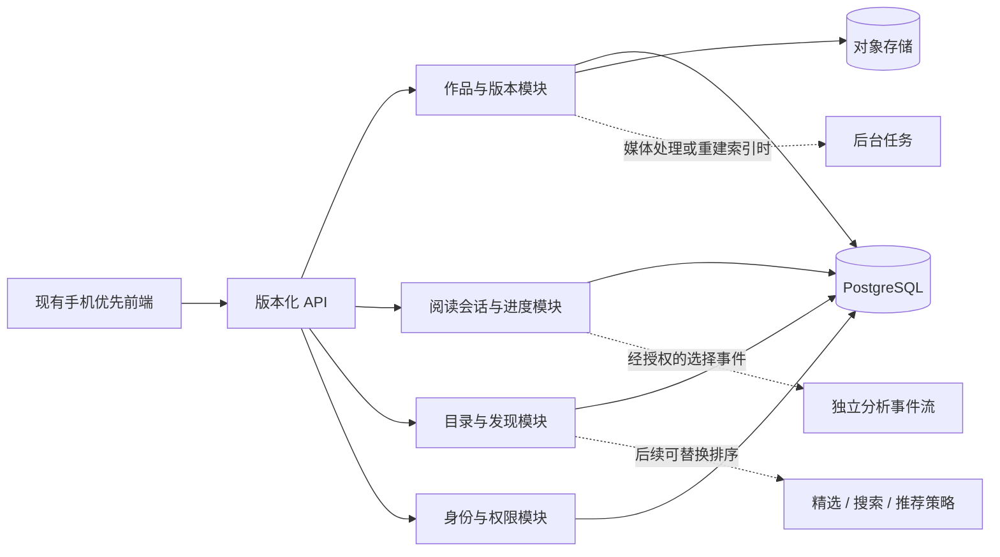

# 信息雨后端架构参考调研

- 日期：2026-09-29
- 范围：社交媒体、内容平台、互动叙事引擎、后端平台与相关开放协议
目的：从现有本地前端 Demo 推导需要哪些后端职责，并辨认哪些已有架构可以借鉴。

状态更新（2026-09-30）：下文对“19 部内嵌 HTML + 4 个注册包”的描述是调研当时的代码状态。现有 23 部作品已统一迁入静态内容池，见[决定 0014](../../project/decisions/0014-unified-distribution-content-pool.md)；后端职责与正式数据模型仍是后续阶段的研究建议。

## 结论摘要

在本次抽样检查的项目中，**没有找到一个可直接安装、且同时覆盖分支作品图、跨作品发现、读者路径状态、内容版本与社交账号的完整 Information Rain 同类平台**。但它的主要架构层都已有成熟参照：Ink/Twine 处理交互内容与运行时；Bluesky AT Protocol 将权威用户数据、事件汇流、应用索引视图和 feed 算法分开；Mastodon/Lemmy/PeerTube 提供真实平台的账号、内容 API、异步作业、媒体存储、管理与运营经验；Supabase 等提供数据库、身份、权限、存储和 API 等后端积木。

因此适合借鉴**职责边界和数据流**，不必照搬任何一个平台的全部技术栈。针对现阶段，优先候选是一个可独立演进的**模块化单体后端 + PostgreSQL + 内容对象存储**；推荐、复杂事件流、视频转码、实时连接和跨站联邦按阶段加入。此为调研建议，不是已批准的技术选型。

## 产品与项目架构比较

| 产品/项目 | 主要架构抽象 | 对信息雨可借鉴之处 | 不能直接照搬的部分 |
|---|---|---|---|
| **Mastodon** 社交平台 | Web/API、实时流、后台任务分成不同运行进程；PostgreSQL 保存主数据；Redis 为时间线/队列/通信提供支撑；媒体可放本地或 S3 兼容对象存储 | 账号与权限、内容 CRUD、feed 更新、后台任务和实时推送的边界；当流量变大时怎样拆分 Web、streaming 和 worker | 产品核心是关注关系与时间线；不需要一开始就做 ActivityPub 联邦、常驻 WebSocket、Redis/Sidekiq 多队列或多实例部署。[官方扩容文档](https://docs.joinmastodon.org/admin/scaling/) |
| **Bluesky / AT Protocol** | PDS 持有用户的权威数据；Relay 汇集并转发仓库事件；App View 建立应用查询/聚合视图；Feed Generator 将算法独立成服务；Lexicon 统一数据调用语义 | 最有价值的**平台分层参照**：原始内容/状态、索引视图、发现排序可以分开；feed 算法可替换；数据 schema/API 可明确定义 | 它是为多服务商与跨服务网络设计的分布式协议。DID、Relay、Firehose、跨服务同步和全球索引会大幅增加首版复杂度，当前没有需求支撑。[协议总览](https://atproto.com/guides/overview)、[AT Stack](https://atproto.com/guides/the-at-stack) |
| **ActivityPub** 联邦协议（Mastodon、Lemmy、PeerTube 使用） | W3C 标准分开定义客户端到服务器的发布/读取 API 与服务器间 federation；Activity/Actor/Object/Inbox/Outbox 形成互通数据语义 | 可为将来开放作者/作品跨平台订阅与传播提供协议参考；客户端 API 和联邦层可先后建设，不必同时实现 | 标准围绕社交活动与 Actor/Inbox/Outbox，未定义信息雨的 story graph、选择语义或推荐信号；实现 federation 需要来源验证、签名、拒收、删除传播和反滥用。[W3C 规范](https://www.w3.org/TR/activitypub/) |
| **PeerTube** 视频平台 | 浏览器 SPA 与服务器 API 分离；PostgreSQL 存元数据；Redis 缓存及 BullMQ 队列；长任务由 worker/远程 runner 做转码；视频可放对象存储，插件可扩展 | 内容元数据与大型媒体文件分开；导入、缩图、转码等长任务走异步队列；API 可服务替代前端；插件/runner 提供后续扩展点 | 当前内容以文字为主。FFmpeg、HLS、P2P、分片冗余和视频规模估算目前均不是 MVP 的必要组件。[架构说明](https://docs.joinpeertube.org/contribute/architecture)、[对象存储](https://docs.joinpeertube.org/maintain/remote-storage) |
| **Lemmy** 社区/链接讨论平台 | 后端 API 与前端分别维护；PostgreSQL 数据模型与 Rust API；ActivityPub 负责跨站社区与活动；有 OpenAPI 与独立 JS 客户端 | 证明不同前端可以共用稳定 API；内容类型、社区归属、权限、审核、API 客户端可形成清晰契约；可研究其帖子与评论模型 | 以帖子、评论、投票及社区为中心，不表达故事节点、路径分支和阅读会话。ActivityPub 联邦仅在跨站互动被列为产品目标后再评估。[贡献者架构概览](https://join-lemmy.org/docs/contributors/01-overview.html)、[API 与自定义前端](https://join-lemmy.org/docs/contributors/04-api.html) |
| **Discourse** 社区论坛 | Rails 后端与 Ember 前端；插件可扩展前后端；Redis 支持缓存、Sidekiq 任务和 MessageBus 实时消息 | 用户、讨论区、通知、审核、插件和成熟运营流程的参照；用户规模增加后工作进程和消息总线承担什么职责 | 论坛主题/回帖是线性讨论模型。对当前阅读器加完整论坛、消息总线和插件框架会扩大产品面。[开发架构介绍](https://meta.discourse.org/t/introduction-to-discourse-development/349939/1) |
| **Ink / inkjs** 互动叙事引擎 | 作者源文件编译成版本化 JSON；运行时输出文本与当前 choices；运行状态可序列化/恢复；渲染 UI 由宿主应用控制 | 最贴近信息雨“作品内部”的结构：稳定节点/分支、选择状态、内容格式与阅读 UI 解耦；参考其编译、格式版本、运行时测试和保存恢复 | Ink 是叙事引擎，不是内容门户或账号后端；它的脚本语义和状态机比当前 23 部作品的固定图节点更通用，须先评估迁移成本。[项目说明](https://github.com/inkle/ink)、[JSON 运行时格式](https://github.com/inkle/ink/blob/master/Documentation/ink_JSON_runtime_format.md) |
| **Twine** 超文本叙事工具 | 故事由 passages 及链接组成，故事格式负责解释 passages 并输出可运行页面；可导出单个 HTML | 参考中立内容包、story format/renderer 分层、静态导出、第三方创作工具接入；与当前 `world-entry.js` 注册器理念相近 | Twine 的默认交付是可独立运行的 HTML/客户端存档；它不提供服务端内容目录、跨设备路径状态、用户身份或推荐系统。[格式规范](https://github.com/iftechfoundation/twine-specs/blob/master/twine-2-storyformats-spec.md) |

## 后端与内容平台框架比较

| 框架/平台 | 已提供的能力 | 对当前前端的适配价值 | 风险或边界 |
|---|---|---|---|
| **Supabase** | PostgreSQL、Auth、自动生成 REST/GraphQL API、Storage、Edge Functions、Realtime；数据库是 Auth/Storage/Realtime 等服务共享的核心 | 可快速把静态作品目录迁移为可查询的关系数据；逐步补登录、作品 API、媒体上传与服务端逻辑；支持现有 JS 前端；Postgres 也方便保留复杂作品图关系。[架构](https://supabase.com/docs/guides/getting-started/architecture)、[数据库](https://supabase.com/docs/guides/database/overview) | 直接暴露客户端数据 API 时必须先设计 RLS 与最小权限，不能把服务端密钥放进浏览器；客户端不应直接随意写入核心内容表。Realtime 和 Edge Functions 不需要因为存在就启用；需确认托管/自托管、备份与费用边界。[RLS 与数据库起步](https://supabase.com/docs/guides/database/overview) |
| **Directus** | 连接现有 SQL 数据库并反射 schema，动态生成 REST/GraphQL API；提供数据管理 UI、角色权限、事件钩子及资产管理 | 可快速探索给编辑者使用的内容管理台，减少首期自建后台；适合以数据库 schema 驱动内容管理的方案。[架构](https://docs.directus.io/getting-started/architecture)、[API](https://docs.directus.io/reference/introduction) | 许可证在 2026 年的 v12 起已从 BSL 1.1 改为 Monospace Sustainable Core License 1.0；核心版适用许可有使用边界，部分功能受许可证等级控制。它是 source-available，不能按不受限制的 OSI 开源依赖看待；采用前须按当前版本与组织情况核对完整许可。[当前许可证](https://github.com/directus/directus/blob/main/directus/license)、[v12 发布说明](https://github.com/directus/directus/releases) |

## 抽象架构核对

符号：**● 直接覆盖**；**◐ 部分覆盖/需自建领域模型**；**— 不是其职责**。表中的参照分别负责不同层，因此不能把任一列视为完整方案。

| 信息雨所需能力 | Mastodon | AT Protocol | PeerTube | Ink/Twine | Supabase/Directus |
|---|:---:|:---:|:---:|:---:|:---:|
| 账号、身份与授权 | ● | ● | ● | — | ● |
| 版本化的互动作品图 | ◐ | ◐（记录/schema） | ◐（媒体元数据） | ● | ◐（数据工具，不含领域语义） |
| 阅读会话、当前路径与恢复 | ◐（通用用户状态） | ◐（仓库可存记录） | ◐（播放状态） | ◐（Ink 运行时状态可序列化；仍需应用侧会话服务） | ◐（需设计表与 API） |
| 跨作品目录与发现 feed | ●（关注时间线） | ●（App View/feed generator） | ◐（视频目录） | — | ◐（需自建查询/排序） |
| 选择事件与个性化依据 | ◐（社交活动） | ◐（事件流/记录） | ◐（观看活动） | ◐（故事内选择，不等于跨作品推荐） | ◐（可存储，语义与算法自建） |
| 图片/视频资产与长任务 | ● | ◐（Blob/仓库） | ● | — | ●（储存基础；重转码另加队列） |
| 社区治理与内容审核 | ● | ●（标签/治理服务） | ● | — | ◐（权限可配，治理流程需自建） |
| 跨实例联邦 | ● | ● | ● | — | — |

**抽象是否存在：存在，但分散在多种系统中。**可归纳为“权威内容与用户状态 → 内容/事件索引 → 独立发现策略 → 客户端体验运行时”，再由身份、媒体、权限、审核和运维提供支撑。尚未从该样本中找到兼有互动故事图、读者路径持久化、跨作品信息流和创作者工具的现成开源一体化实现。

## 面向 Information Rain 的候选架构

### 首版领域边界

1. **作品与版本（权威源）**：把现有 19 部内置作品和 4 个注册包作为导入来源；建立 `Work`、`WorkVersion`、`Node`、`Choice/Edge`、`MediaAsset`。作品 ID、版本 ID、节点 ID、选择 ID 要稳定；运行中的会话绑定到具体作品版本，内容修订后旧进度仍可解释。导入校验继续验证 ID、节点计数、断链、可达性、封面比例和哈希。
2. **阅读运行与状态**：建立 `ReaderSession`、`PathEvent`、`Bookmark/LibraryEntry`。选择事件至少能关联作品版本、当前节点、当时实际展示的 choices 和所选 choice；路径顺序独立保存。先把“路径回放/恢复”做正确，再考虑从选择推导兴趣。
3. **目录与发现**：先实现编辑精选、类别/主题筛选、搜索、随机或规则排序；所有策略只返回作品/版本 ID 和排序理由，阅读器仍负责加载内容。把 discovery 做成模块边界，日后可替换为新排序服务，无需改写作品图。
4. **身份、权限与编辑**：决定匿名本地进度是否继续作为过渡，何时引入账号、跨设备同步、作者和审核角色。内容编辑发布、普通读者、管理员的权限要分离；发布前留存授权来源和内容状态。
5. **媒体与异步任务**：初期封面和插画使用对象存储；单纯上传/缩图需要时再引入任务队列。短视频进入路线后再加转码 worker、播放格式、字幕和成本限制。
6. **观察与治理**：区分技术日志、匿名化产品事件、用户可识别的阅读路径。路径选择可能透露敏感倾向；推荐实验必须单独说明目的、同意、留存和删除方式，不默认收集或上传。

### 推荐的演进顺序（建议，未批准为排期）

| 阶段 | 目标 | 最小验收证据 |
|---|---|---|
| A. 数据契约与存储 | 定义作品包 schema、版本语义、API 契约；导入现有内容而不丢路径 | 23 部内容可重建并通过现有结构校验；前端从 API 取目录及图内容 |
| B. 服务端阅读状态 | 会话、进度、收藏与恢复；先明确匿名身份与登录边界 | 同一读者中断后恢复到正确版本/节点；版本升级不会错接路径 |
| C. 内容管理与角色 | 内部编辑/发布、审核状态、权利元数据、操作记录 | 作者或编辑可安全更新草稿，未发布内容对普通访问不可见 |
| D. 发现与推荐 | 先做精选/搜索，再试验可解释规则； choice-level 信号须另行授权 | 至少有可对比的非个性化基线；推荐理由可读、可关闭、可重置 |
| E. 插画/视频与规模能力 | 对象存储、媒体处理队列、CDN/成本与保留策略 | 上传/处理失败可恢复，作品和进度不因媒体任务失败丢失 |
| F. 运行保障 | 环境隔离、权限审计、备份恢复、监控、费用和回退 | 非生产验证、最近一次恢复演练和版本回退证据齐备 |

## 对现有项目的直接启示

- 当前分发 Demo 是单文件 HTML + 内嵌 19 部作品 + 注册器生成的 4 部内容。`registry.json` 与 `registry.generated.js` 已形成“内容源文件/校验注册表/运行时产物”三层雏形，适合作为第一批后端导入适配器的来源；它不是正式领域数据库。
- 决定 0006 明确工具产品和分发产品是两个产品。建议各自有边界清楚的 API/权限/迭代节奏；可复用内容 schema 或作者身份，但不预设共享代码库、共享数据库或账号。
- 作品路径由内容决定，不把 `left/right/up` 当稳定选择语义。持久化 `choiceId` 与作品版本，方向只作为当前 UI 的展示位置。
- “推荐即生成”是长期方法设想，当前数据均为预写内容。因此先把内容交付、运行与发现三层分开，不应把模型生成、向量库、事件流或个性化误写成第一版后端的前提。
- 正式上线需过现有阶段门：身份/权限、测试与生产隔离、失败恢复、备份回退、费用和监控；当前架构调研不能替代这些验收。

## 尚待项目所有者选择

1. 首个后端目标仅支持内容目录与路径状态，还是同一阶段加入编辑后台？建议先完成导入、只读目录和阅读状态，再加编辑流程。
2. 账号是内部试用前必须具备，还是先采用匿名/本地进度？这会影响权限、隐私和跨设备验收。
3. 优先托管后端服务快速验证，还是自托管以掌握部署？Supabase 是候选基础服务，不是已选平台。
4. 未来创作工具与分发产品是否共享作品包 schema/API，需在工具产品产生真实数据和用例后决定。
5. ActivityPub/AT Protocol 联邦是否属于中长期产品价值；在有跨服务分发、身份迁移或第三方开发者需求前建议保持为未来兼容点，不投入协议实现。

## 主要一手资料

- [W3C ActivityPub Recommendation](https://www.w3.org/TR/activitypub/)：客户端到服务器发布 API 与服务器间 federation 是两个层次，可分别实现。
- [AT Protocol Protocol Overview](https://atproto.com/guides/overview) 与 [The AT Stack](https://atproto.com/guides/the-at-stack)：PDS、Relay、App View、Feed Generator 与 Lexicon 的职责定义。
- [PeerTube Architecture](https://docs.joinpeertube.org/contribute/architecture)：客户端、反向代理、API、数据库、缓存/队列、转码和 runner 的总体关系。
- [Mastodon Scaling Guide](https://docs.joinmastodon.org/admin/scaling/) 与 [Object Storage](https://docs.joinmastodon.org/admin/optional/object-storage/)：Web、streaming、Sidekiq、Redis、PostgreSQL、对象存储及扩容边界。
- [Lemmy Contributor Overview](https://join-lemmy.org/docs/contributors/01-overview.html) 与 [API Guide](https://join-lemmy.org/docs/contributors/04-api.html)：前后端独立、客户端 API 与 federation library。
- [Ink GitHub](https://github.com/inkle/ink)、[Ink JSON Runtime Format](https://github.com/inkle/ink/blob/master/Documentation/ink_JSON_runtime_format.md)、[Runtime State source](https://github.com/inkle/ink/blob/master/ink-engine-runtime/StoryState.cs) 与 [Architecture and Development Overview](https://github.com/inkle/ink/blob/master/Documentation/ArchitectureAndDevOverview.md)：脚本到 JSON runtime、choice 和可序列化运行状态。
- [Twine 2 Story Formats Specification](https://github.com/iftechfoundation/twine-specs/blob/master/twine-2-storyformats-spec.md)：passage 数据、故事格式解释器和独立 HTML 输出。
- [Supabase Architecture](https://supabase.com/docs/guides/getting-started/architecture)、[Database](https://supabase.com/docs/guides/database/overview) 与 [Auth Architecture](https://supabase.com/docs/guides/auth/architecture)：Postgres、身份、API、Storage、Realtime 和 Edge Functions。
- [Directus Architecture](https://docs.directus.io/getting-started/architecture)、[API Reference](https://docs.directus.io/reference/introduction)、[current MSCL license](https://github.com/directus/directus/blob/main/directus/license) 与 [v12 release notes](https://github.com/directus/directus/releases)：数据库反射 API、权限、当前许可和功能许可边界。
- [Discourse Architecture Introduction](https://meta.discourse.org/t/introduction-to-discourse-development/349939/1)：Rails/Ember 平台核心与插件扩展。
